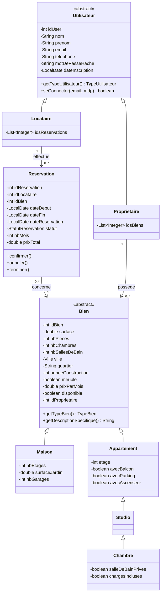
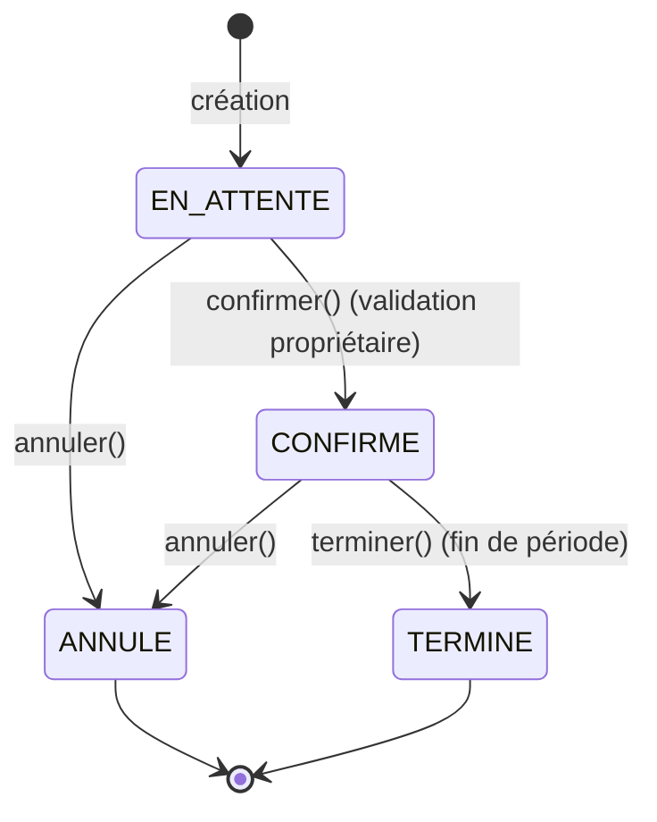

# Diagramme UML — Application de Location Immobilière

Ce document fournit le diagramme de classes complet. Il est donné au format
**PlantUML** (rendu via l'extension *PlantUML* de VS Code ou sur
<https://www.plantuml.com/plantuml>) et au format **Mermaid** (rendu directement
par l'aperçu Markdown de VS Code).

---

## 1. Diagramme de classes (PlantUML)

```plantuml
@startuml
skinparam classAttributeIconSize 0
skinparam style strictuml
left to right direction

' ===================== ENUMERATIONS =====================
enum Ville { CASABLANCA \n RABAT \n NADOR \n OUJDA }
enum TypeBien { MAISON \n APPARTEMENT \n STUDIO \n CHAMBRE }
enum StatutReservation { EN_ATTENTE \n CONFIRME \n ANNULE \n TERMINE }
enum TypeUtilisateur { PROPRIETAIRE \n LOCATAIRE }

' ===================== HIERARCHIE BIEN =====================
abstract class Bien {
  - idBien : int
  - surface : double
  - nbPieces : int
  - nbChambres : int
  - nbSallesDeBain : int
  - ville : Ville
  - quartier : String
  - anneeConstruction : int
  - meuble : boolean
  - prixParMois : double
  - disponible : boolean
  - idProprietaire : int
  + {abstract} getTypeBien() : TypeBien
  + {abstract} getDescriptionSpecifique() : String
}

class Maison {
  - nbEtages : int
  - surfaceJardin : double
  - nbGarages : int
}

class Appartement {
  - etage : int
  - avecBalcon : boolean
  - avecParking : boolean
  - avecAscenseur : boolean
}

class Studio {
  ' nbPieces forcé à 1
}

class Chambre {
  - salleDeBainPrivee : boolean
  - chargesIncluses : boolean
}

Bien <|-- Maison
Bien <|-- Appartement
Appartement <|-- Studio
Studio <|-- Chambre
Bien --> Ville
Bien ..> TypeBien

' ===================== HIERARCHIE UTILISATEUR =====================
abstract class Utilisateur {
  - idUser : int
  - nom : String
  - prenom : String
  - email : String
  - telephone : String
  - motDePasseHache : String
  - dateInscription : LocalDate
  + {abstract} getTypeUtilisateur() : TypeUtilisateur
  + seConnecter(email, mdp) : boolean
  + modifierProfil(...) : void
}

class Proprietaire {
  - idsBiens : List<Integer>
  + ajouterBien(idBien) : void
  + retirerBien(idBien) : void
}

class Locataire {
  - idsReservations : List<Integer>
  + ajouterReservation(idRes) : void
}

Utilisateur <|-- Proprietaire
Utilisateur <|-- Locataire
Utilisateur ..> TypeUtilisateur

' ===================== RESERVATION =====================
class Reservation {
  - idReservation : int
  - idLocataire : int
  - idBien : int
  - dateDebut : LocalDate
  - dateFin : LocalDate
  - dateReservation : LocalDate
  - statut : StatutReservation
  - nbMois : int
  - prixTotal : double
  + confirmer() : void
  + annuler() : void
  + terminer() : void
}

Reservation --> StatutReservation
Locataire "1" --> "0..*" Reservation : effectue
Reservation "0..*" --> "1" Bien : concerne
Proprietaire "1" --> "0..*" Bien : possède

' ===================== COUCHES (DAO / SERVICE / CONTROLEUR) =====================
interface Repository<T> {
  + sauvegarder(T) : T
  + trouverParId(int) : Optional<T>
  + trouverTout() : List<T>
  + supprimer(int) : boolean
  + existe(int) : boolean
}
interface BienDAO
interface UtilisateurDAO
interface ReservationDAO
Repository <|-- BienDAO
Repository <|-- UtilisateurDAO
Repository <|-- ReservationDAO

class InMemoryBienDAO
class InMemoryUtilisateurDAO
class InMemoryReservationDAO
BienDAO <|.. InMemoryBienDAO
UtilisateurDAO <|.. InMemoryUtilisateurDAO
ReservationDAO <|.. InMemoryReservationDAO

class BienService
class UtilisateurService
class ReservationService
BienService --> BienDAO
UtilisateurService --> UtilisateurDAO
ReservationService --> ReservationDAO
ReservationService --> BienDAO

class BienController
class UtilisateurController
class ReservationController
BienController --> BienService
UtilisateurController --> UtilisateurService
ReservationController --> ReservationService

class MainFrame
MainFrame --> BienController
MainFrame --> UtilisateurController
MainFrame --> ReservationController
@enduml
```

---

## 2. Diagramme de classes (Mermaid — rendu natif dans VS Code)



---

## 3. Diagramme d'état d'une réservation



> **Règle :** la confirmation rend le bien indisponible ; l'annulation d'une
> réservation confirmée ou sa terminaison libèrent le bien (s'il n'a plus
> d'autre réservation confirmée active).
